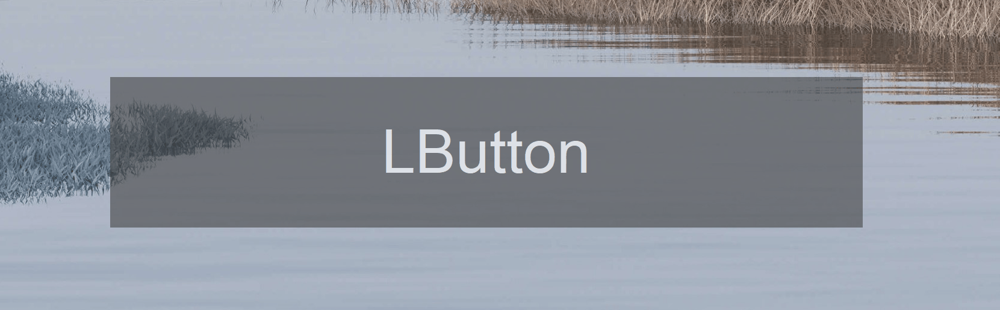
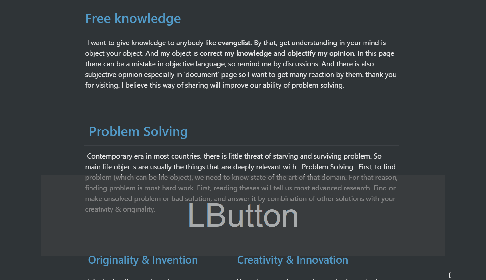

# Screencast
## Press Overlay of keyboard and mouse like vscode screencast

### Show Pressed


### Typing Test


When you **Share screen** or **Screen Capture**, you can show what you type or click
**화면공유**나 **스크린 캡쳐** 시 어떤 것을 타이핑하고 있는지를 보여줄 수 있습니다


### Install program and run


Impressed by [ShowOff](https://www.dcmembers.com/skrommel/download/showoff/), VSCode Screencast

<br/>

# [Download](https://github.com/seonglae/screencast/releases/latest/download/Screencast.exe)
### Or more simply, install by command
```bash
winget install screencast
```

<br/>

# Usages
## Shortcuts
Global Shortcut
- `left alt + r` - Restart overlay (click OK on the `Reload Start` box). While the overlay runs it keeps this shortcut, so other apps don't receive it

After Click Overlay
- Click Overlayer & `alt + f4` - End Overlay 

or you can close program in system tray 


## Move
Drag the overlay with the left mouse button. It starts at the bottom center of the screen and goes back there when it restarts.

## Settings
Right-click the tray icon and choose **Settings...** to open `cast.ini`. Edit the values under `[Settings]`, save, then press `left alt + r` so the overlay restarts with them.

| Key | Default | Meaning |
| --- | --- | --- |
| `backcolor` | `424242` | Background color, hex `000000`-`FFFFFF` |
| `fontcolor` | `ffffff` | Text color, hex `000000`-`FFFFFF` |
| `fontsize` | `60` | Font size |
| `boldness` | `200` | Font weight `1`-`1000` (`400` normal, `700` bold) |
| `font` | `Arial` | Font name |
| `statuswidth` | `1000` | Overlay width |
| `statusheight` | `200` | Overlay height |
| `transparency` | `150` | `0` (invisible) to `255` (opaque), or `Off` |
| `timetoshow` | `1000` | How long the last keys stay on screen, in ms |

The lines after the settings are the keys and buttons the overlay watches, one per line, named as in [AutoHotkey's key list](https://www.autohotkey.com/docs/v1/KeyList.htm). Delete a line to stop showing that key (for example `RButton` for right clicks), or add a key on a new line above `LButton`. Keep `LButton`: dragging the overlay needs it.

<br/>


# Made with
- [Dancing Button](https://github.com/seonglae/dancing-button)
- Electron
- AHK
